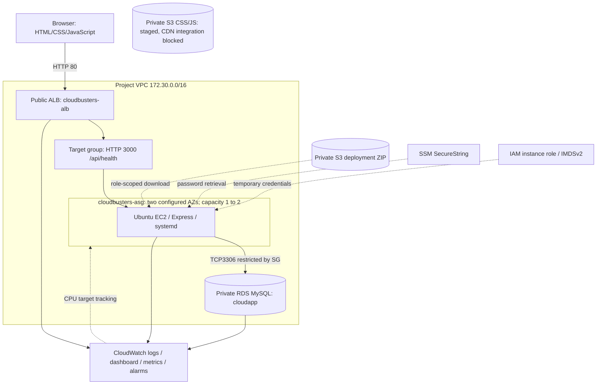

# Actual architecture

Only implemented services are shown. CloudFront is absent because AWS rejected creation pending account verification.

- ALB spans public subnets 172.30.10.0/24 (1a) and 172.30.11.0/24 (1b).
- EC2 uses those public subnets for inexpensive outbound access, with application inbound access restricted to the ALB Security Group. No NAT Gateway was intentionally added.
- RDS public access is disabled according to the handover; live verification is recorded in CURRENT_STATE.md.
- Security group chain: Internet TCP80 → ALB SG → app SG TCP3000 → RDS SG TCP3306.
- Target tracking: average ASG CPU target 50%, minimum 1 / maximum 2, health grace 600 s, policy warmup 300 s.
- Desired=1 does not provide continuous two-AZ app availability. Automatic replacement has startup delay; RDS Multi-AZ is a separate setting.
- Static resources bucket contains no credentials or source ZIP. CDN integration is prepared but not active.
- Innovation is service integration: repeatable role-based provisioning, health-based routing, managed data, monitoring and automatic infrastructure response. No new scaling algorithm is claimed.
- Original standalone EC2 was retained during tests; CURRENT_STATE.md records its final state.
